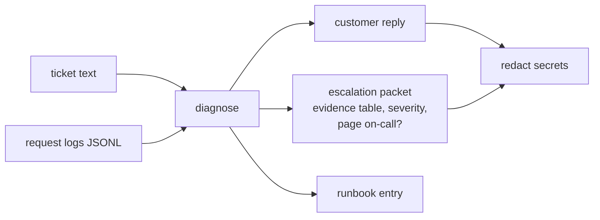

# integration-triage

A support-engineer toolkit. Give it a customer ticket and the request logs, and it names the root
cause, cites the failing request IDs, drafts the customer reply, writes the engineering escalation
packet, and keeps a runbook for next time. Secrets are redacted on the way out. It also runs as an
MCP server, so an agent can triage a ticket itself.

> **Unofficial.** Not affiliated with Merge or any other vendor. It is built from public
> documentation and **synthetic** logs. No real customer data and no vendor internals are used.



## Why this exists

A support engineer's loop is the same every time: find the failing calls, name the cause, tell the
customer what to do, and hand engineering something they never have to ask a follow-up about. Most of
the cost is in the details: "Your API is down!" turns out to be a rate limit, a 404 is really a key
scoped to the wrong user, a customer pasted a live key into the ticket. This tool encodes that loop
and tests it.

## Quickstart (no keys, no network)

```bash
pip install -e ".[dev]"
pytest -q                 # 83 tests
triage eval --check       # 58 labelled incidents, gated against evals/baseline.json
make demo                 # diagnose examples/outage.jsonl end to end
triage runbooks           # regenerate docs/runbooks/
```

```text
$ triage diagnose --logs examples/outage.jsonl --ticket-file examples/outage.ticket.txt
cause      : Third-party service outage [upstream_outage]  confidence 0.90
severity   : sev1   escalate: yes   page on-call: YES   users: 3
evidence   : req_wwxk8x, req_9cj357, req_x5sauv, req_yzfw76, req_vmn5te
```

### Bring your own logs

Input can be **JSON lines, a JSON array, a JSON object wrapping a list, or CSV**. Common field names
from other platforms are recognised automatically (`requestId`, `status_code`, `response.status`,
`timestamp`, `durationMs`, `headers.Retry-After`, nested `error.code` / `error.message`, ...). For
anything else, pass a mapping file of field to dotted path:

```bash
triage diagnose --logs examples/rotated_key.export.csv --mapping examples/rotated_key.mapping.json
```

Only a status is strictly required; a missing request id is replaced by `record-N`. Timestamps
from ISO strings with any offset, `YYYY-MM-DD HH:MM:SS` or epoch seconds/milliseconds are
normalised to UTC so mixed sources sort correctly. Bad records are skipped and reported as
warnings instead of failing the whole file. The more of `ts`, `user_id`, `connector`,
`key_prefix`, `upstream_status`, `retry_after`, `cursor`, `source` and a latency `breakdown` you
include, the more causes it can tell apart.

## Run it as a service (free)

```bash
triage-serve                                   # http://localhost:8080, docs at /docs in dev
# or: cp .env.example .env && docker compose up -d
```

| Endpoint | What it does |
|---|---|
| `POST /v1/diagnose` | `{"ticket": ..., "logs": "<raw export>", "mapping": {...}, "incident_id": ...}` returns the cause, severity, page-on-call flag, cited request IDs, customer reply, escalation packet and parse warnings. Idempotent on `incident_id`. |
| `GET /v1/incidents?escalated=true` | The engineering queue. |
| `POST /v1/incidents/{id}/resolution` | Record what the cause actually was. |
| `GET /v1/stats` | Volume, sev1 count, causes, and **diagnosis accuracy on resolved incidents**: the tool's accuracy on real tickets, not on my test set. |
| `GET /v1/causes`, `GET /v1/runbooks/{cause}` | The catalog and its runbooks. |
| `GET /healthz`, `/readyz` | Probes. |

Production behaviour, each covered by tests:

- **Secrets and PII never leave.** Known key shapes (Stripe-style, GitHub, Slack, AWS, Google,
  LangSmith, JWTs, bearer tokens, `api_key=` query strings, private key blocks), emails, phone
  numbers and Luhn-valid cards are removed. A second layer catches **key formats nobody listed**:
  any long token mixing letters and digits with near-random characters. Request IDs cited as
  evidence are protected so replies still point at the right calls. Only redacted text is stored.
- **Locked down in prod:** `TRIAGE_ENV=prod` refuses to start without API keys of at least 16
  characters, hides `/docs`, compares keys in constant time, and rate-limits per key.
- **Bounded:** request bodies over `TRIAGE_MAX_BODY_MB` get `413`; more than `TRIAGE_MAX_ENTRIES`
  records gets a clear "filter to the incident window" error. About 3 s to parse 100k lines on a
  laptop; diagnosis itself is milliseconds.
- **Observable:** JSON logs with a request id; ticket text and logs are never logged.

Operations: [`docs/OPERATIONS.md`](docs/OPERATIONS.md). Validating on real platform errors:
[`docs/REAL_LOGS.md`](docs/REAL_LOGS.md).

## What it can diagnose

| Cause | Severity | Engineer needed | Basis |
|---|---|---|---|
| Key not scoped to the requested user (404 "Resource not in API key scope.") | sev3 | no | public docs |
| Free-plan limit reached (402 `billing_limit_reached`) | sev3 | no | public docs |
| Per-user rate limit (429, Retry-After) | sev3 | no | public docs |
| Invalid, revoked or rotated API key (401) | sev3 | no | public docs |
| Call blocked by a security or guardrail rule | sev3 | no | public docs |
| Sustained platform latency (overhead above 500 ms) | sev2 / sev1 | yes | public docs |
| Slow third-party app (overhead normal) | sev3 | no | public docs |
| End-user authorization expired | sev3 | no | general practice |
| Connected account lacks a permission | sev3 | no | general practice |
| Third-party outage (5xx across several users) | sev2 / sev1 | yes | general practice |
| Client re-requests the same cursor | sev3 | no | general practice |
| Webhook signature verification failing | sev3 | no | general practice |
| MCP tool not available on the connection (JSON-RPC -32602 inside HTTP 200) | sev3 | no | public docs |
| Not enough information | sev3 | no | asks for request IDs |
| Failures with no known pattern | sev2 | yes | escalates |

"Public docs" means the behaviour is quoted from Merge's public
[Agent Handler FAQ](https://docs.merge.dev/merge-agent-handler/resources/faq); the two exact
strings used (`billing_limit_reached` and "Resource not in API key scope.") come from there. Every
other error string in this repo is illustrative.

Design choices worth noting:
- It **asks instead of guessing**: no logs, or only healthy ones, produces a reply asking for a
  request ID and a UTC time, not an escalation.
- When two patterns overlap, the **dominant one wins** and the runner-ups are listed as alternatives.
- A low-confidence match escalates rather than sending a confident wrong answer.
- Outages and sustained latency scale severity with users affected, and sev1 says to page on-call.

## Use it from an agent (MCP)

```json
{ "mcpServers": { "integration-triage": { "command": "triage-mcp" } } }
```

Tools: `diagnose_incident(logs_jsonl, ticket)`, `get_runbook(cause_id)`, `list_causes()`. Output is
already redacted and includes `escalate` and `page_oncall` flags. Tested over a real stdio
connection (mcp 2.3.0).

## How it is tested

58 labelled incidents in three groups:

| Group | Cases | Where they come from |
|---|---|---|
| standard | 45 | generated by `simulate.py` (`triage simulate`) |
| hard | 5 | hand-built conflicts: 429s mixed with 502s, an angry ticket blaming the wrong thing, one user with three 503s |
| wild | 13 | hand-written separately, with different log shapes (nested `error` objects, `Retry-After` headers, no timestamps) and different phrasing; the 13th is an MCP JSON-RPC error, written together with its matcher, so it is not an independent test |

Metrics: cause accuracy (overall, hard, wild), escalation correctness and recall, evidence validity
(every cited request ID exists in the logs), **no secret leak** (planted keys must not appear in any
reply or packet) and reply quality (cites IDs, gives numbered steps, no promises, no blame, short).
`triage eval --check` fails CI if a score drops below `evals/baseline.json`, with zero tolerance for
leaks and missed escalations.

The checks can fail. Turning redaction off drops the leak score from 1.00 to 0.53 (this is a test in
the suite), and disabling the rate-limit matcher drops cause accuracy to 0.89.

## Limits

- **All 1.000 scores are on data I wrote.** The standard cases come from my own generator and the
  matchers were built against the same patterns, so they mostly show the pipeline is consistent. The
  wild set is the fairer test: it scored 11/12 on its first run (a bare `401 Authentication failed`
  was missed), I generalized one matcher, and it now scores 12/12. Treat it as a development set
  now, not an unseen benchmark.
- **Not yet run against a live platform.** Agent Handler signup requires a company email, which I
  don't have as an individual, so the MCP behaviour was tested against a local mock built from
  Merge's public docs (MCP URL format, `X-Request-ID`, JSON-RPC invalid-params errors), not
  real responses. Building that mock is what exposed the JSON-RPC-inside-HTTP-200 gap, now fixed.
  Anyone with a test key can run [`scripts/capture_agent_handler.py`](scripts/capture_agent_handler.py)
  in about two minutes and see how it does on real errors ([`docs/REAL_LOGS.md`](docs/REAL_LOGS.md)).
- Entropy-based redaction errs towards removing: a 40-character git commit hash, for example, is
  redacted. Request IDs cited as evidence are protected.
- Single instance: SQLite storage and an in-process rate limiter. No TLS; put a proxy in front.
- Matching is rule-based on purpose: it is fast, free and explainable, and every conclusion cites
  its evidence. It has no LLM, so it cannot read free-text stack traces or customer prose beyond a
  few keywords.
- Thresholds (for example "3 or more calls", "500 ms") are judgment calls, written down in
  `causes.py`.
- Replies are templated. They are accurate and short but not warm; a person should read one before it
  is sent.

## Layout

```
src/integration_triage/
  causes.py     cause catalog + matchers (what each cause is, how to confirm it, what to say)
  diagnose.py   scoring, dominant-cause selection, severity, escalation
  compose.py    customer reply, escalation packet, runbook entry
  checks.py     reply quality checks      redact.py   secret redaction
  evaluate.py   metrics + baseline gate   simulate.py synthetic incident generator
  mcp_server.py MCP tools                 cli.py      `triage` command
  api.py        HTTP service             service.py  diagnose + store + resolutions
  logs.py       log loader (aliases, mapping, CSV, timestamps)
  store.py      SQLite incident history  config.py   settings, validated at startup
  data/         cases.jsonl (generated), wild_cases.jsonl (hand-written)
docs/runbooks/  one generated runbook per cause
examples/       sample logs and tickets
```

## License

MIT
